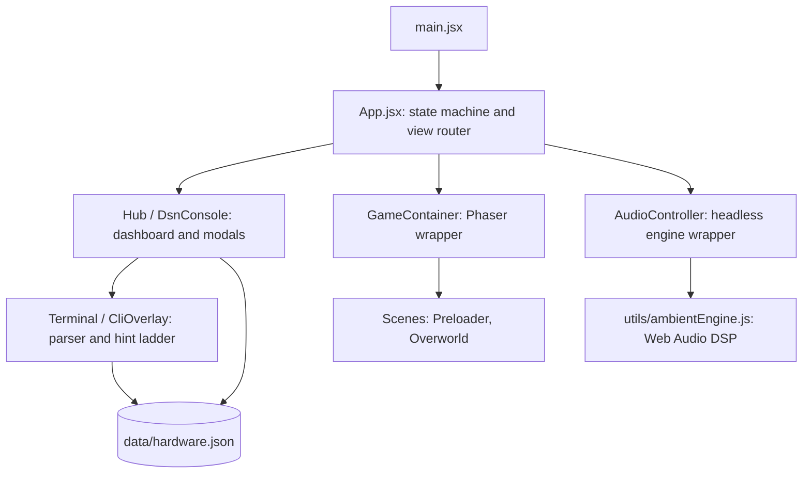

# DSN Space Archaeology & Telemetry Recovery Terminal

**Re-establish contact. Diagnose the silence. Recover the science.**

A retro 16-bit web app built for the **NASA Space Apps Challenge**, combining historical space exploration, CRT terminal puzzles, and generative ambient soundscapes.

---

## Overview

You play a **Deep Space Network (DSN) engineer** re-establishing communication links, diagnosing subsystem anomalies, and recovering lost science payloads from uncrewed NASA missions.

| Layer | Role |
|---|---|
| **Hub & Spoke DSN Console** | Dashboard of spacecraft distances, signal strengths, and recovery status |
| **Retro CRT Terminal** | Command parser with a spoiler-free, tiered hint system |
| **Phaser 2D Canvas** | Retro surface-traversal gameplay for field operations |
| **Generative Audio Engine** | Endless ambient soundscape built from short NASA clips |

---

##  Key Features

- **Hub & Spoke Console:** open any mission from the overview dashboard to start a recovery.
- **Retro CRT Terminal (`CliOverlay`):** scanline and phosphor styling with `scan`, `status`, `ping`, `decode telemetry`, and `help`.
- **Progressive Hint Disclosure:** "Need a hint?" reveals help in tiers (nudge, then command type, then exact command), so players diagnose first.
- **Generative Web Audio:** stochastic pitch-shifting, panning, and stereo delays turn brief archive clips into a non-repeating ambience.
- **2D Retro Exploration:** Phaser 3 scenes (`Preloader`, `Overworld`) for surface traversal.

---

## Missions

| Mission | Type | Era |
|---|---|---|
| Pioneer 10 | Outer-planet probe (first to cross the asteroid belt and fly past Jupiter) | 1970s |
| Viking 1 | Mars lander | 1970s |
| Voyager 1 | Interstellar probe (most distant human-made object) | 1970s |
| Spirit | Mars rover | 2000s |
| Opportunity | Mars rover | 2000s |

Specs and telemetry live in [`src/data/hardware.json`](src/data/hardware.json).

---

##  Terminal Commands

| Command | Purpose |
|---|---|
| `help` | List available commands |
| `scan` | Scan subsystems and the signal environment |
| `status` | Report current link and subsystem state |
| `ping` | Test the link to the spacecraft |
| `decode telemetry` | Decode recovered telemetry into a science payload |

---

## 🏗️ Architecture



---

##  Tech Stack

| Area | Technology |
|---|---|
| Frontend | React 19, Vite |
| Styling | Tailwind CSS, custom CRT scanline and phosphorescent themes |
| Game engine | Phaser 3 |
| Audio | Native Web Audio API (buffer management and DSP) |
| Data | Static JSON |

---

##  Project Structure

```text
.
├── public/
│   ├── assets/
│   │   ├── audio/              # NASA historical sound clips and ringtones
│   │   └── payloads/           # Dithered science scans (AI-watermarked)
│   ├── control_room.jpeg       # DSN control room backdrop
│   └── favicon.svg
├── src/
│   ├── components/
│   │   ├── Hub/                # DsnConsole dashboard and modals
│   │   ├── Terminal/           # CliOverlay and input parser
│   │   ├── AudioController.jsx # Ambient engine wrapper and toggle
│   │   └── GameContainer.jsx   # Phaser canvas wrapper
│   ├── scenes/                 # Phaser scenes (Preloader, Overworld)
│   ├── utils/                  # ambientEngine.js
│   ├── data/                   # hardware.json
│   ├── App.jsx                 # Root state machine and view router
│   └── main.jsx                # React entry point
└── README.md
```

---

##  Getting Started

**Prerequisites:** Node.js v18+, npm or yarn, and a modern browser with Web Audio support.

```bash
git clone https://github.com/your-username/space-archaeology-dsn.git
cd space-archaeology-dsn
npm install
npm run dev        # development server (usually http://localhost:5173)
npm run build      # production build
```

**Troubleshooting**

- **No sound:** browsers block audio until a user gesture. Click the audio toggle first.
- **Blank canvas:** check the console and confirm files exist in `public/assets/`.
- **Install errors:** upgrade to Node 18+.

---

##  AI Disclosure

In line with NASA Space Apps Challenge transparency rules, **Super Intelligence (AI) was used in this project**:

| Area | AI use |
|---|---|
| **Science payload images** | Retro dithered pixel art in `public/assets/payloads/` was generated with AI tools. Each image carries a visible corner watermark reading `AI GENERATED`. |
| **Code and development** | AI assistance was used for coding, debugging, and design iteration. |
| **Documentation** | This README was drafted and refined with AI assistance. |

All AI output was reviewed by the team. Mission facts come from NASA sources listed below.

---

##  Data & Asset Attribution

| Asset | Source |
|---|---|
| **Mission data and payload context** | Publicly available NASA archives and mission logs (`hardware.json`) |
| **Audio** | Clips and radio wave sonifications from the official **NASA Historical Sounds Library**, processed in the browser via the Web Audio API |

Thanks to **NASA**, the **Deep Space Network**, the **NASA Space Apps Challenge** community, and the maintainers of React, Vite, Tailwind CSS, and Phaser.

---

##  Contributing

1. Fork the repo and create a branch: `git checkout -b feature/your-feature`
2. Commit and push your changes.
3. Open a pull request.

Credit sources for any new assets and watermark any AI-generated imagery.

---

##  License

Open-source submission for the NASA Space Apps Challenge. See [`LICENSE`](LICENSE) for terms.
